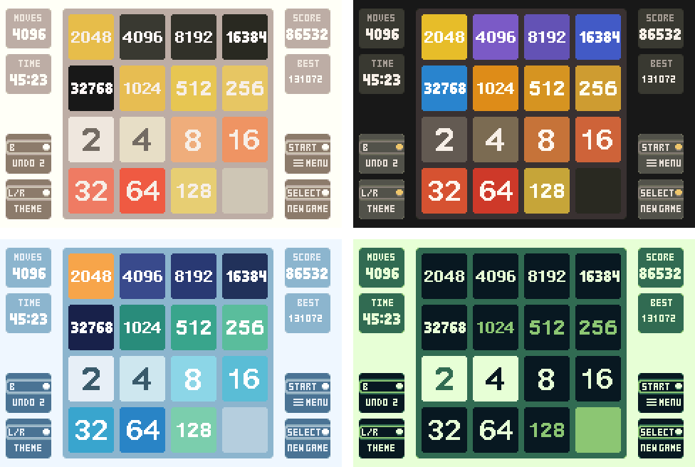
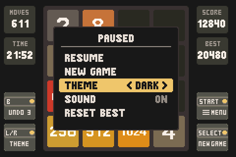
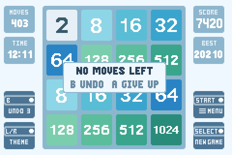

# 2048 Advance — Enhanced Fork

An enhanced fork of **2048 Advance**, the Game Boy Advance port of 2048 by
[Basil Termini / Paperdomo101](https://github.com/Paperdomo101/2048-GBA)
([play the original on itch.io](https://basil-termini.itch.io/2048-advance)).

This fork builds on upstream **v1.3.1** and adds new features on top of it. All credit for the
original game, its art, audio and engine goes to its author and contributors.



## Enhancements over the original

Everything this fork adds or changes compared with upstream v1.3.1:

| Area | Change |
|---|---|
| Gameplay | **Keep playing after 2048** — the win screen offers *Keep playing* or *New game*; new 16384 and 32768 tiles, and 4096+ tiles get their own colours |
| Gameplay | **Undo** (B) with 3 charges per game; merging a 512 or bigger tile earns a charge back |
| Gameplay | **No moves left?** If you still have undos, the game offers *Undo* or *Give up* instead of ending immediately |
| Gameplay | SELECT asks for confirmation before throwing away a game in progress |
| Themes | **Four colour themes** — Classic, Dark, Ocean and Retro — switchable with L/R or from the pause menu; they apply to every screen and are remembered |
| Interface | **Pause menu** (START): resume, new game, theme, sound on/off, reset best score |
| Interface | On-screen prompts use **button icons** (A, B, START, SELECT, L, R) |
| Interface | The empty left side of the screen now shows **moves**, **play time**, undo charges and the L/R theme button |
| Saving | **Auto-save** after every move and setting change, replacing the START "Saving..." screen |
| Fixes | Scores of 100,000 and above are now drawn correctly (they were garbled before) |
| Docs | Controls reference, Windows build instructions, screenshots |

See the [fork changelog](#fork-changelog) for details per release.

<p>
  
  
</p>

## Controls

| Input | Action |
|---|---|
| D-pad | Slide tiles |
| B | Undo the last move (up to 3 in a row) |
| START | Pause menu |
| SELECT | New game (press twice to confirm) |
| L / R | Previous / next colour theme |
| A | Give up when no moves are left |

On the title and Game Over screens press any button to continue. On the You Win screen press
**A** (or START) to keep playing, or **SELECT** for a new game.

Reach the 2048 tile to win, then keep going for 4096 and beyond. The game saves automatically
to cartridge SRAM after every move, so it resumes where you left off on the next boot.

## Building

Requires [devkitPro](https://devkitpro.org/wiki/Getting_Started) with the `gba-dev` package group
(devkitARM, libtonc, maxmod, grit, mmutil, gbafix). The ROM is written to `build/2048 Advance.gba`;
run it in an emulator such as [mGBA](https://mgba.io) or on hardware via a flash cart.

### Windows

Run the CMake build from the devkitPro MSYS2 shell
(`C:\devkitPro\msys2\msys2_shell.bat`, or `C:\devkitPro\msys2\usr\bin\bash.exe -l`):
```sh
cmake -B build .
cmake --build build
```

### nob
```sh
cc -o nob nob.c 
./nob # [options]
      # -r / run:       run in emulator after build  
      # -m / multiboot: build multiboot ROM
      # -d / debug:     define _DEBUG
      # example ./nob -md run   build multiboot, debug, and run 
```

### cmake
```sh
cmake -G Ninja -B build . 
cmake --build build
```

Options: `-DMULTIBOOT=ON` builds a Multiboot ROM (`2048 Advance_mb.gba`);
`-DCMAKE_C_FLAGS=-D_DEBUG` enables debug hotkeys (L = force lose, R = force win).
When adding source, graphics or audio files, list them in `CMakeLists.txt`.

## Contributing

See [CONTRIBUTING.md](CONTRIBUTING.md) for the code style and how to add scenes and sounds.

## Fork changelog

### v1.4
+ Keep playing after reaching 2048; added 16384 and 32768 tiles; 4096+ tiles have their own palette
+ Undo with the B button: 3 charges per game, merging a 512+ tile earns one back
+ "No moves left" prompt offering undo or give up while undo charges remain
+ Colour themes: Classic, Dark, Ocean and Retro (L/R or pause menu), applied to all screens
+ Pause menu on START: resume, new game, theme, sound on/off, reset best score
+ Left-hand stats column: moves, play time, undo charges, theme button; START button relabelled MENU
+ Auto-save after every move and setting change (replaces the save screen)
+ SELECT asks for confirmation before starting a new game mid-game
+ Button prompts are drawn as button icons (round A/B, pill START/SELECT/L/R); the pause menu shows A/B hints
* Scores of six and seven digits are drawn with compact digits instead of overlapping
* "+N" score popup is skipped for merges worth more than 9999 points (it only fits four digits)
* Save format v3: older saves keep only their best score
* Starting a new game right after a slide no longer drops an extra tile on the new board
* The game-over countdown pauses while the pause menu is open
* Undo history is kept when you choose *Keep playing* after a win
* A damaged save with an empty board starts a new game instead of a stuck one
+ Controls reference, Windows build instructions and screenshots in the README

## Original changelog

Releases of the upstream project, [Paperdomo101/2048-GBA](https://github.com/Paperdomo101/2048-GBA).

### v1.3.1
* Fixed a bug allowing input when 2048 has been achieved

### v1.3
+ Added nob build system alongside CMake
+ Separated score logic out from gameplay code into [score.c](source/score.c)
+ Added contributing guidelines (CONTRIBUTING.md)
+ Added huge merge sound effect
* Updated all sound effects (except slide / spawn sounds)
* Sound effects are now declared under SFX_LIST in [global.h](include/global.h) and statically defined automatically using x macros
* Redesigned scene system with SCENE_LIST and x macros - scenes are now implemented in [source/scenes](source/scenes)
* Fixed a graphical bug causing parts of squares to vanish with OAM sorting
* Fixed scale animations freezing while sliding animation is playing
* Fixed initial full scale frame in merge animation
* Scene change now occurs at the start of the next frame instead of at the call-site
* Modified CMake graphics pipeline to work with nob setup
* Upgraded storage format to v2 with hi-score backwards compatibility
* Reverted removal of .grit graphics config files 
* Changed .gitignore to a whitelist
- Reverted L+R+Select hi-score reset and last-save return from Game Over: will move to pause menu

### v1.2 contributed by [@carstene1ns](https://github.com/carstene1ns)
+ Implemented highscore resetting with L+R+Select on title screen.
+ Allow returning to last saved game from Game Over screen.
+ Allow running as Multiboot ROM
* Fixed playfield display on Game Over/Win screen
* Save battery with better vsyncing
* Stop tally animation when out of screen

### v1.1
+ Implemented saving: press start to save and the game will resume where you left off.
* Fixed score tallying
* Fixed error in gameover check
* Fixed while-loop hang save crash
